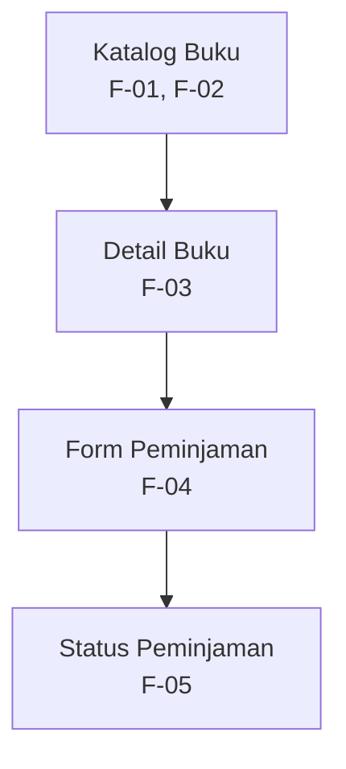

# Information Architecture — Perpustakaan Kampus

## 1. Inventaris Halaman

| No. | Nama Halaman | ID Kebutuhan | Fungsi Halaman |
|---|---|---|---|
| 1 | Katalog Buku | F-01, F-02 | Menampilkan daftar buku dan menyediakan pencarian berdasarkan judul atau kategori. |
| 2 | Detail Buku | F-03 | Menampilkan informasi detail buku dan ketersediaannya. |
| 3 | Form Peminjaman | F-04 | Memungkinkan mahasiswa mengajukan peminjaman buku yang tersedia. |
| 4 | Status Peminjaman | F-05 | Menampilkan status pengajuan peminjaman buku. |

## 2. Diagram Information Architecture

## 3. Alasan Pemilihan Halaman Utama

Halaman Katalog Buku dipilih sebagai halaman utama karena mahasiswa perlu melihat daftar buku dan mencari buku berdasarkan judul atau kategori sebelum melakukan peminjaman. Halaman ini mendukung kebutuhan F-01 dan F-02 serta sesuai dengan persona Rani sebagai mahasiswa yang memiliki jadwal kuliah padat dan membutuhkan akses informasi buku secara praktis melalui smartphone.

Prototype Tugas 5 berfokus pada rancangan halaman utama Katalog Buku. Halaman Detail Buku, Form Peminjaman, dan Status Peminjaman dicantumkan sebagai bagian dari arsitektur informasi aplikasi, tetapi belum seluruhnya diimplementasikan pada prototype ini.
